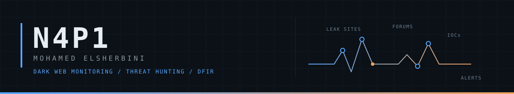

<div align="center">



# Mohamed Elsherbini

Security researcher in Egypt. I build tooling for the defensive side: collecting signal from ransomware leak sites and underground forums, hunting for intrusions, and turning both into something an analyst can use.

[focus](#focus) · [work](#work) · [research](#research) · [toolbox](#toolbox) · [activity](#activity) · [elsewhere](#elsewhere)

[](https://ieeexplore.ieee.org/document/11765755)
[](https://ctftime.org/team/418706)

</div>

---

## Focus

| | |
|:---|:---|
| **Dark web monitoring** | Ransomware leak sites, hacker forums, underground chatter — collected, parsed, and turned into IOCs and alerts that can actually be actioned. |
| **Threat hunting** | Hypothesis-led hunting across telemetry, mapping activity to TTPs, and turning what turns up into detections that hold. |
| **DFIR & malware** | PE triage, malware analysis, reverse engineering, incident response. CTFs with [N!ghtM4re](https://ctftime.org/team/418706) — 4th in Egypt — keep the reps in. |

I also publish peer-reviewed research on embedded systems security; that paper is [below](#research).

---

## Work

### [Night-Watch](https://github.com/N4P1x/Night-Watch)

Dark web and ransomware threat intelligence platform. Actively maintained.

- Monitors ransomware leak sites, hacker forums, and dark web threat sources
- Automated IOC extraction and real-time alerting
- Tor-aware collection, FastAPI backend, React dashboard, Redis, Docker

### Also built

| Project | What it does | Built with |
|:---|:---|:---|
| [Malware-Hunter](https://github.com/N4P1x/Malware-Hunter) | PE header analysis with machine learning, enriched with VirusTotal, behind a web UI. | `Python` `Flask` `scikit-learn` `VirusTotal` |
| [YoRHa-Deauther](https://github.com/N4P1x/YoRHa-Deauther) | ESP32 Wi-Fi deauthentication testing with a browser interface, built on ESP-IDF. | `C++` `ESP-IDF` `Web UI` |
| [mini-ter](https://github.com/N4P1x/mini-ter) | Arch Linux + Hyprland desktop with a Material You theming engine. | `Shell` `Wayland` `Hyprland` |
| [Writeups](https://github.com/N4P1x/Writeups) | 19 challenges from GPN, HackTheBox, and SecLeaf — crypto, pwn, reverse, forensics, web. | `Markdown` `Python` |

---

## Research

### Cyber-FIE: A Software-Induced Memory Fault Injection Framework for Evaluating AES-256 Resilience on ESP32

A. E. Takieldeen, Z. A. Mashaly, **M. H. El Sherbini**, H. M. Attia, S. H. Hagag, E. A. Takieldeen  
*2026 International Telecommunications Conference (ITC-Egypt)*, pp. 56–61, New Capital, Egypt, July 2026.

[IEEE Xplore](https://ieeexplore.ieee.org/document/11765755) · [doi:10.1109/ITC-EGYPT70422.2026.11765755](https://doi.org/10.1109/ITC-EGYPT70422.2026.11765755) · [Paper repository](https://github.com/N4P1x/Research-Papers) · [PDF](https://github.com/N4P1x/Research-Papers/raw/master/Cyber-FIE.pdf)

**The idea.** Fault injection normally means a lab: voltage glitches, lasers, a bench setup. Cyber-FIE asks how far C++ pointer arithmetic gets you — direct writes into the stack, heap, and live AES-256 context of an ESP32-D0WDQ6, with no ECC RAM and no physical attacker.

**What we measured.**

- **3,560** hardware trials over four months
- **100%** functional failure against legacy DES/3DES (1,240/1,240)
- **12.3%** critical failures against AES-256 (95% CI 11.2–13.4%), at **14.7 µs** fault latency
- **28.0%** system crashes at higher injection rates — watchdog timer tripping on corrupted state; most of the work was timing calibration
- **Shield**, a self-healing protocol plus a lightweight runtime integrity check, recovered **94.2%** of keys; the remaining 5.8% was largely hash collisions and race conditions

**My part.** The injection engine, the ESP32 test harness, and the timing calibration that made the results repeatable.

<details>
<summary>Cite this paper</summary>

```bibtex
@inproceedings{takieldeen2026cyberfie,
  title     = {Cyber-FIE: A Software-Induced Memory Fault Injection Framework
               for Evaluating AES-256 Resilience on ESP32},
  author    = {Takieldeen, Ali E. and Mashaly, Ziad A. and
               El Sherbini, Mohamed H. and Attia, Haitham M. and
               Hagag, Sayed H. and Takieldeen, Eslam A.},
  booktitle = {2026 International Telecommunications Conference (ITC-Egypt)},
  pages     = {56--61},
  year      = {2026},
  doi       = {10.1109/ITC-EGYPT70422.2026.11765755}
}
```

</details>

---

## Toolbox

**Intel & hunting** — dark web collection · IOC extraction · threat intelligence · OSINT · threat hunting · SOC workflows · DFIR · malware analysis · reverse engineering · wireless · OT/ICS

**Build** — `Python` `FastAPI` `React` `Redis` `Docker` `Tor` `C++` `ESP32 / ESP-IDF` `Shell` `Linux` `Hyprland` `Nmap` `Metasploit`

---

## Activity

<picture>
  <source media="(prefers-color-scheme: dark)" srcset="https://github-readme-activity-graph.vercel.app/graph?username=N4P1x&theme=tokyo-night&hide_border=true" />
  <source media="(prefers-color-scheme: light)" srcset="https://github-readme-activity-graph.vercel.app/graph?username=N4P1x&theme=github-light&hide_border=true" />
  
</picture>

<picture>
  <source media="(prefers-color-scheme: dark)" srcset="https://raw.githubusercontent.com/N4P1x/N4P1x/output/github-contribution-grid-snake-dark.svg" />
  <source media="(prefers-color-scheme: light)" srcset="https://raw.githubusercontent.com/N4P1x/N4P1x/output/github-contribution-grid-snake.svg" />
  
</picture>

---

## Elsewhere

[LinkedIn](https://www.linkedin.com/in/mohamed-elsherbini-41671b2b1) · [n4p1.me](https://n4p1.me) · [sh3rb1n1@gmail.com](mailto:Sh3rb1n1@gmail.com) · [CTFtime](https://ctftime.org/team/418706) · [Research papers](https://github.com/N4P1x/Research-Papers)

---

<div align="center">

_Exploiting systems. Securing knowledge._

</div>
